# Oriel

Oriel is a wall-tablet dashboard for Home Assistant, packed into one custom card. It has a frosted-glass look, thirteen colour themes, and a 3D glass house on the home screen that shows who is in which room and where your power is flowing.

Every page and every section is optional. You set it up with a visual editor, and YAML still works if you prefer it.

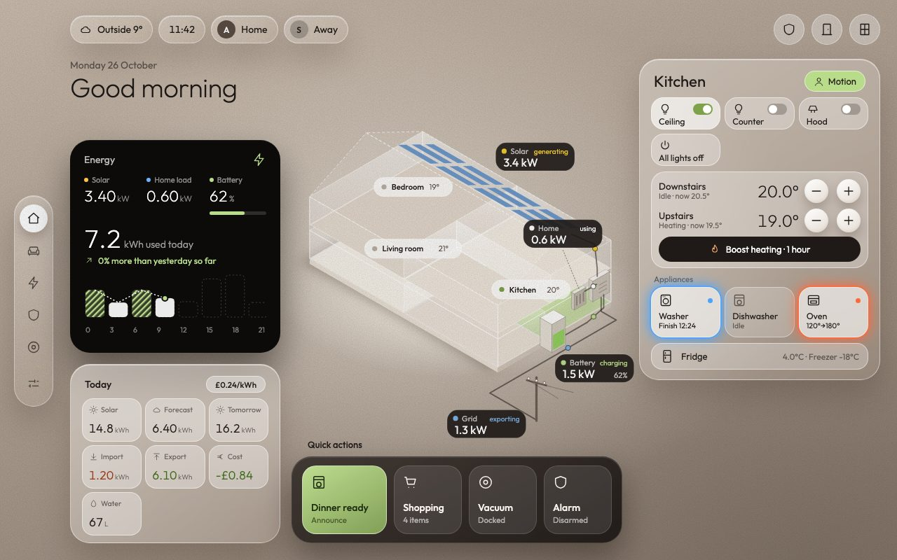

## Pages

A page shows up in the side rail as soon as one of its entities is set.

| Page | What it shows |
|---|---|
| Home | Greeting, weather, clock and people; an energy card comparing today with yesterday; Today tiles and quick actions; a room panel for lights, heating, appliances and the fridge; a shopping list; the next three calendar events; camera pop-ups; and the glass house with room temperatures, presence and live power flow. |
| Living room | Room status, doors and windows, blinds, speaker, scenes, lights (brightness, white and colour), a streamer selector, now playing, TV inputs, movie mode, apps and a remote. |
| Energy | Live flow between solar, house, battery and grid; the battery and its packs; today's totals; a house-use chart; the solar forecast; big consumers; inverter health. Read-only. |
| Climate | Weather with a 5-day row and a next-12-hours chart; thermostats with − and + and a heating boost; a 12-hour temperature graph; room temperatures with the coldest and warmest named. |
| Household | A shopping list you can tick, add to and clear; a merged calendar for today, tomorrow and this week; bin collections; an optional second to-do list; Nova's reminders when Nova is on. |
| Security | Alarm status, doors and windows, presence by floor, camera snapshots with live view on tap, recent events and device health. Read-only: it never arms, disarms or unlocks anything. |
| Vacuum | One or more robot vacuums: status, controls with confirm steps, cleaning settings and schedule. Dreame vacuums also get the room map, parts and base station. |
| Nova | Chat and controls for the separate Nova assistant. Off unless you turn it on. |
| System | Home Assistant and host status, backups, connections, low batteries, unavailable entities, tablet controls, auto rotation and an optional debug panel. Always shown. |

<table>
<tr><td>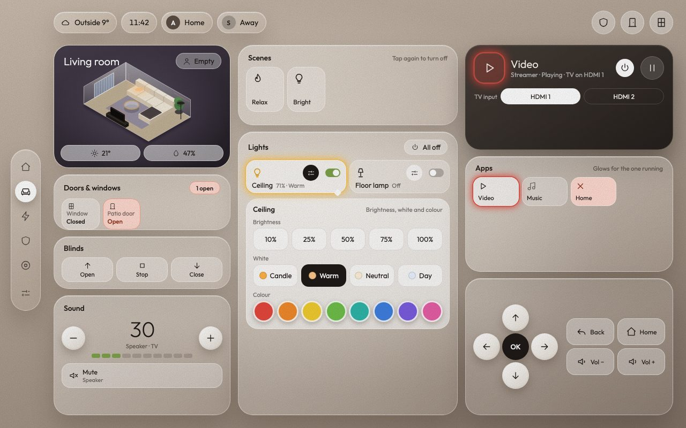</td><td>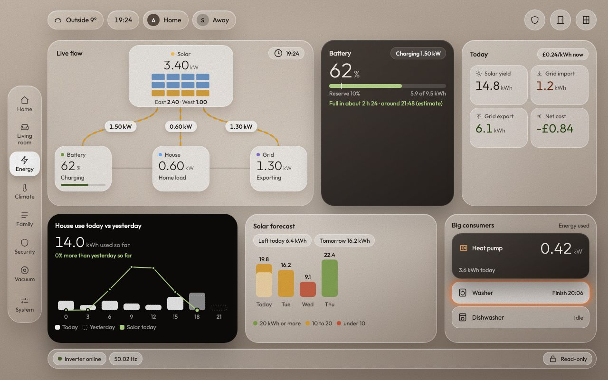</td></tr>
<tr><td>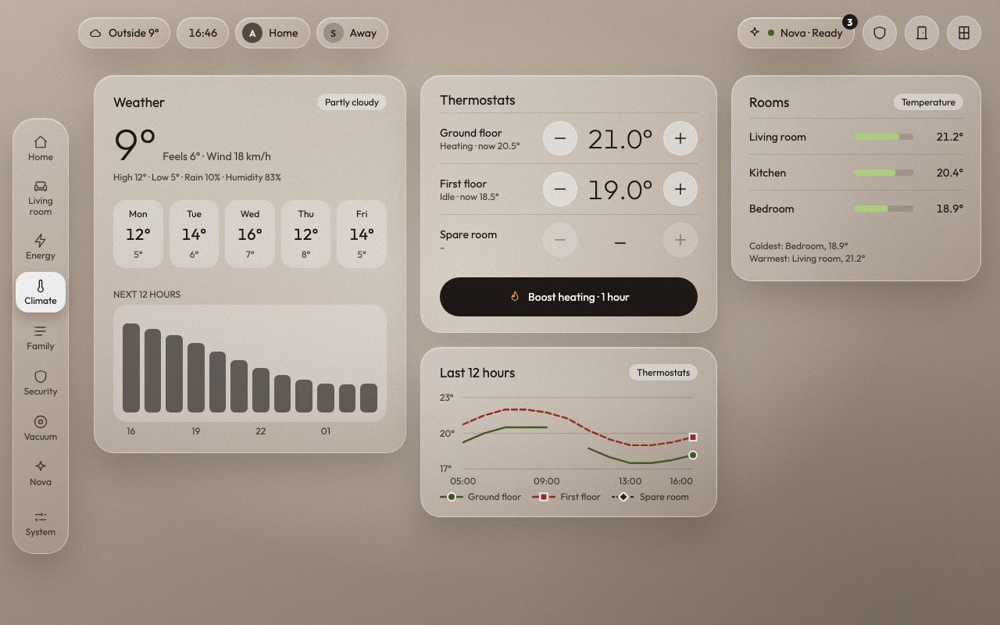</td><td>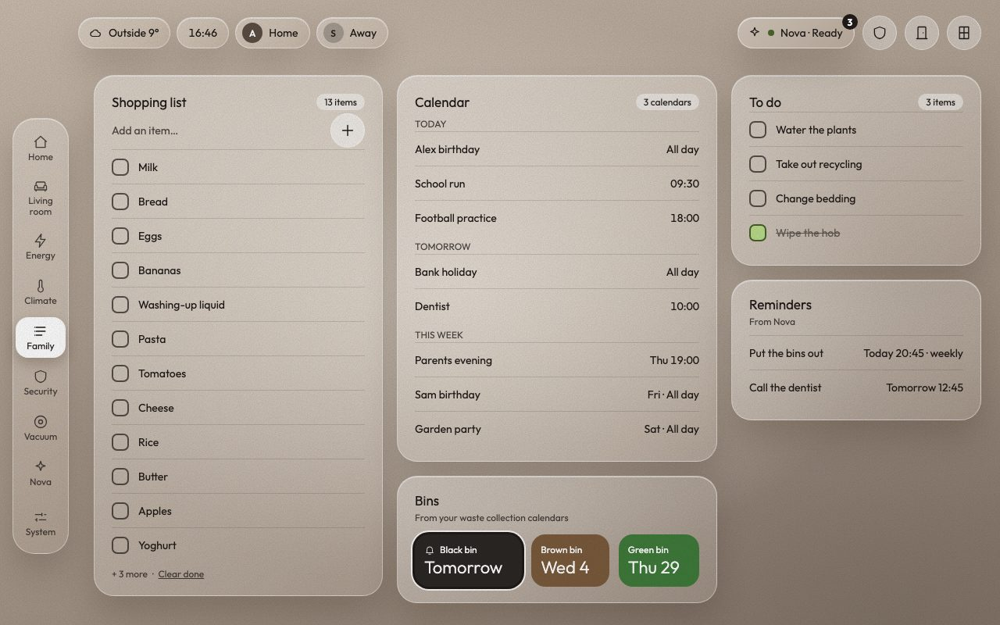</td></tr>
<tr><td>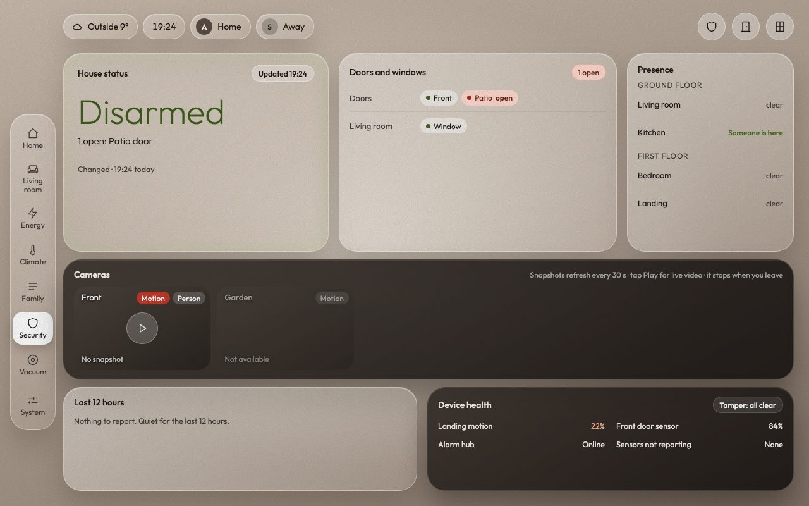</td><td>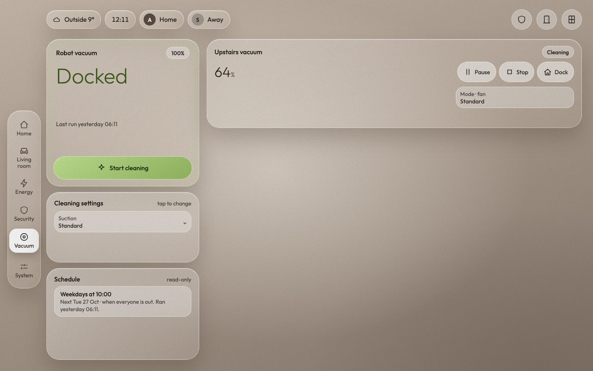</td></tr>
<tr><td>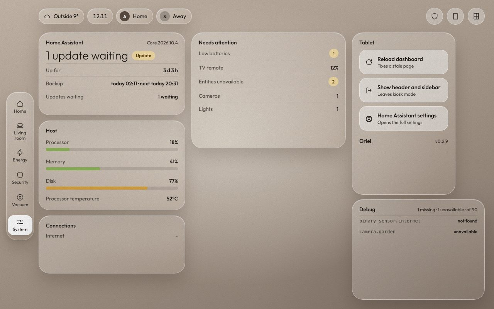</td><td>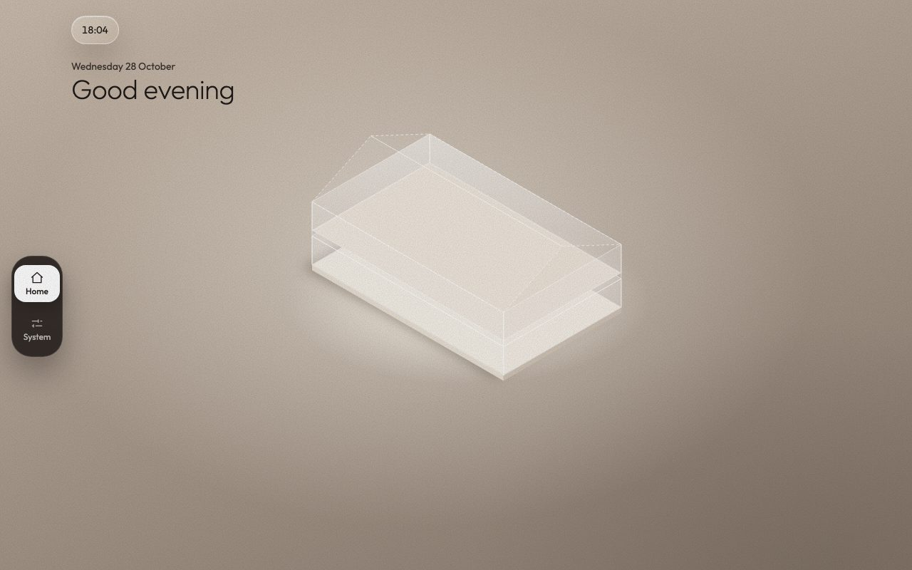</td></tr>
</table>

All screenshots use made-up example data.

## Install

You need Home Assistant 2024.1 or newer, and a tablet or phone to show it on.

### With HACS

1. In Home Assistant, open HACS, then the three-dot menu, then Custom repositories.
2. Add `https://github.com/abz2much/oriel` with the type Dashboard.
3. Find Oriel in HACS, download it, and reload your browser when asked. HACS adds the resource for you.

### By hand

1. Download `oriel.js` from the latest release.
2. Copy it to `/config/www/oriel/oriel.js`.
3. In Settings › Dashboards › ⋮ › Resources, add `/local/oriel/oriel.js?v=0.7.3` as a JavaScript module. Raise the `?v=` number each time you update the file, then hard-refresh the tablet.

## Quick start

1. Create a dashboard (Settings › Dashboards › Add dashboard), open it, choose Edit dashboard, and set the view type to Panel (single card).
2. Add a card and choose Oriel, or use `type: custom:oriel-shell` in a manual card.
3. Open a section in the editor and press Auto-detect. Tick the suggestions you want, fill in the rest, and save.

With nothing set you get the greeting, the clock, a plain glass house and the System page. Add things one section at a time.

The editor groups everything into sections (General, Home, Living room and so on). Auto-detect looks at your entities and suggests matches, but nothing changes until you press Apply, and it never touches a field you have already filled. If an entity does not exist or is the wrong type, the editor warns you as you type; you can still save, and the tablet shows a dash for it. Show code editor switches to YAML at any time.

## Looks

Pick one of thirteen themes under General › Theme, or set your own accent colour. Every theme is checked for readable contrast. See [Themes](docs/features.md#themes) for the full list.

For a bolder tablet look, turn on the scene style (General › Page style on the tablet). Energy, Climate, Household, Security, Vacuum and System then get a large title with status chips, a drawing of the page's subject with live labels, and compact cards that fit the screen. Tap a card to open the full version. See [Scene style](docs/features.md#scene-style).

<table>
<tr><td>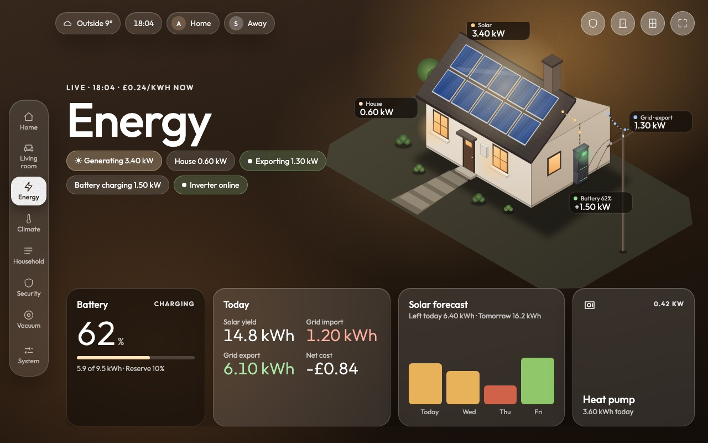</td><td>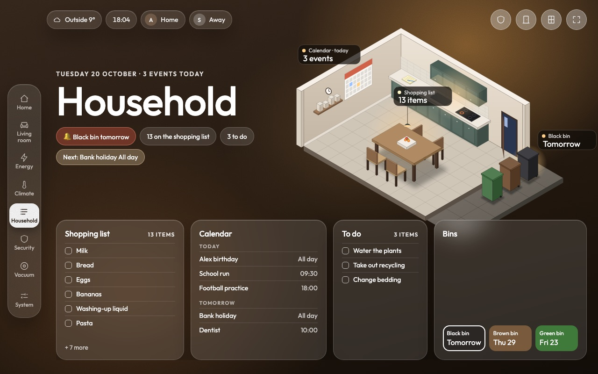</td></tr>
</table>

## Also included

- On a narrow screen the same card turns into a scrolling single column with a tab bar ([phone layout](docs/features.md#phone-layout)).
- A dark clock screen can cover the tablet when nobody is in the room and go away when someone comes back ([idle clock](docs/features.md#idle-clock)).
- The tablet can step through the pages by itself, pausing after a touch ([auto rotation](docs/features.md#auto-rotation)).
- A button in the header hides Home Assistant's header and sidebar, with no add-on needed ([wall tablet setup](docs/features.md#wall-tablet-setup)).

## Privacy and safety

Oriel loads nothing from the internet: the font is bundled and the icons are built in. Security and Energy are read-only, so Oriel never arms, disarms, unlocks or opens anything. Starting the vacuum, cleaning rooms and resets always ask first, with an extra warning at night. On Climate and Household, Oriel only changes what you ask for, such as a thermostat target or an item on your list. It does not show who changed the alarm, only whether the change was automatic.

## Documentation

- [Configuration](docs/configuration.md): every option, the house plan and Nova.
- [Features in detail](docs/features.md): themes, scene style, idle clock, auto rotation, the phone layout, wall tablet setup, troubleshooting and accessibility.
- [Development](docs/development.md): building, testing and releasing.
- [Changelog](CHANGELOG.md)

## Support

Oriel is free and stays free. If you would like to say thanks:

## Licence

MIT, see [LICENSE](LICENSE). The bundled Outfit font is © The Outfit Project Authors under the SIL Open Font License 1.1 ([src/fonts/OFL.txt](src/fonts/OFL.txt)).
