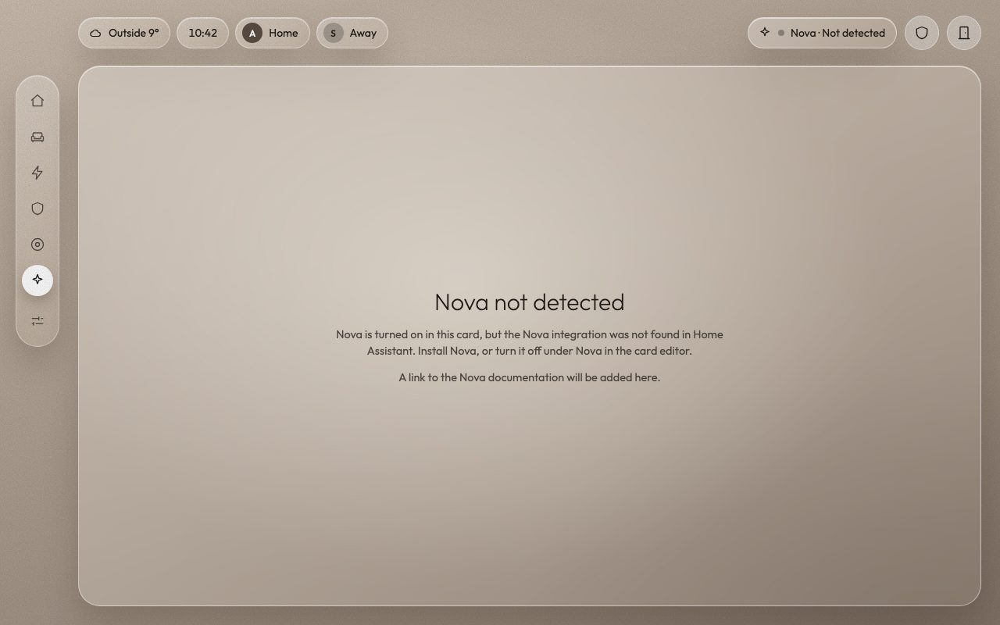

# Configuration

Every key is optional. The visual editor writes all of this for you, so you only need this page if you prefer YAML or want to know what a field does. Entity fields take an entity ID, and the expected domain is in brackets. A full example with made-up entities is in [`example.yaml`](example.yaml).

```yaml
type: custom:oriel-shell
general: { ... }
home: { ... }
living: { ... }
energy: { ... }
climate: { ... }
family: { ... }     # the Household page
security: { ... }
vacuum: { ... }
system: { ... }
nova: { ... }
```

A page appears in the side rail once at least one of its entities is set. System is always there.

## general

| Key | Type | Default | What it does |
|---|---|---|---|
| `weather` | entity (weather) | none | Weather chip in the header. |
| `weather_label` | text | "Outside" | Text before the temperature. |
| `people` | list of entities (person) | `[]` | One chip per person. Hidden when empty. |
| `people_display` | `initial`, `name` or `hidden` | `initial` | How people chips are labelled. |
| `alarm` | entity (alarm_control_panel) | none | Header button. Also the Security page's panel unless `security.alarm` is set. |
| `front_door` | entity (binary_sensor) | none | Header door button. It turns red when the door is open. |
| `windows` | list of entities (binary_sensor) | `[]` | Header window button. It turns red when any window is open, and a tap opens the first open window (or the first in the list). Hidden when empty. |
| `clock` | true or false | `true` | Clock chip. |
| `currency` | text | `auto` | `auto` uses Home Assistant's currency. Or a code such as `GBP`. |
| `settings_path` | text | `/config` | Where the System page's settings button goes. |
| `theme` | theme id | `classic` | Colour theme, see [Themes](features.md#themes). An unknown id falls back to Classic. |
| `accent` | hex colour | none | Your own accent colour instead of the theme's, such as `"#2457ff"`. |
| `layout` | `auto`, `tablet` or `phone` | `auto` | `auto` uses the phone layout when the card is narrower than 700 px (the card's own width, not the screen's). `tablet` or `phone` forces one. See [Phone layout](features.md#phone-layout). |
| `page_style` | `classic` or `scene` | `classic` | Tablet only. See [Scene style](features.md#scene-style). |
| `idle_clock` | object | off | `presence` (the sensor; empty means no idle clock) and `minutes` (how long the sensor must be off first, default 5, from 1 to 60). See [Idle clock](features.md#idle-clock). |
| `auto_rotate` | object | off | `enabled` (default `false`), `idle_seconds` (default 60) and `after_touch_seconds` (default 300). See [Auto rotation](features.md#auto-rotation). |
| `pages_order` | list | home, living, energy, climate, family, security, vacuum, nova | Order of pages in the rail (YAML only). System always comes last. |

## home

| Key | Type | What it does |
|---|---|---|
| `energy_card.solar_power` | entity (sensor, W or kW) | Solar now. |
| `energy_card.house_power` | entity (sensor, W or kW) | House use now. Its history also feeds the "kWh used today" chart. |
| `energy_card.battery_soc` | entity (sensor, %) | Battery charge. |
| `price` | entity (sensor or input_number) | Price chip on the Today card. |
| `today` | list, up to 9 | Tiles: `label`, `icon`, `entity`, `tone` (`neutral`, `good` or `bad`). |
| `quick_actions` | list, up to 4 | `type` (`script`, `shopping` or `more_info`), `label`, `icon`, `entity`, `subtitle`, `primary` (green). |
| `shopping` | entity (todo) | The shopping list a `shopping` quick action opens. |
| `calendar` | true or false | Default `true`. Shows the "Coming up" card under the room panel. See below. |
| `room_panel.title` | text | Title of the right-hand panel, for example your kitchen. |
| `room_panel.motion` | entity (binary_sensor) | Motion chip. |
| `room_panel.lights` | list | `name`, `entity` (light or switch), `icon`, `all_off` (include in "All lights off", default true). |
| `room_panel.heating` | list | `name`, `entity` (climate), `step` (default 0.5). |
| `room_panel.boost` | object | Heating boost button: `start` and `cancel` (scripts), `timer` (timer), `switch`, `label`. |
| `room_panel.appliances` | list | `name`, `icon`, `colour`, `kind` (`machine` or `cooktop`), `state`, `finish` (timestamp sensor), `run_states`, `pause_states`, `door`, `temperature`, `setpoint`, `burners` (cooktop), `tap_script`. An appliance glows in its colour while it runs. |
| `room_panel.fridge` | object | `door`, `fridge_temp`, `freezer_temp`. |
| `camera_popups` | list | `flag` (input_boolean or binary_sensor), `camera`, `title`. When the flag turns on, a live view pops up. |
| `house` | object | The glass house, see [The house](#the-house). |

The Coming up card lists the next three events from `family.calendars`, soonest first, leaving out the ones that have finished. Each row has a coloured bar for its calendar, the title, the day (Today, Tomorrow or the weekday) and the time. If nothing is planned in the next 7 days it says "Nothing coming up" and gives the date of the next event within 14 days, if there is one. Tapping it opens the Household page. The card is hidden when there are no calendars, or when the room panel is so tall that not even one row fits. Rows are never cut in half; fewer rows are shown instead.

## living

| Key | Type | What it does |
|---|---|---|
| `title` | text | Page title (default "Living room"). |
| `presence`, `temperature`, `humidity`, `illuminance` | entities | Room status chips. |
| `room_render` | true or false | The small room drawing (default true). |
| `openings` | list | `name`, `entity` (binary_sensor), `icon` (`window` or `door`). |
| `blinds` | object | `cover`, `my_position` (button), `subtitle`. |
| `speaker` | object | `media_player`, `label`, `night_sound` (switch), `audio_format` (sensor). |
| `tv` | object | `media_player`, `inputs` (list of `label`, `script`, `source`), `source_labels` (a map from the TV's source value to a friendly name). |
| `streamers` | object | `selector` (input_select, needed to choose between devices) and `devices` (list of `name`, `option`, `icon`, `media_player`, `remote`, `launch`: `script` or `android`). |
| `movie_mode` | object | `start` and `stop` (scripts), `flag`, `on_text`. |
| `lights` | list | `name`, `entity`, `icon`, `colour` (shows the tune panel) and optionally `render`: `uplighter`, `floor_lamp`, `ceiling`, `wall` or `none`, which is where the light glows in the drawing. An odd last light spans both columns. |
| `scenes` | list | `name`, `icon`, `colour`, and either `helper` (input_boolean, toggled) or `scene`. |
| `scene_off_lights` | list of entities | The lights a scene turns off on a second tap (default: all lights above). |
| `apps` | list | `name`, `icon`, `colour`, `script` (for `script` streamers), `package` (Android app, for `android` streamers), `app_id` (to spot it running), `close_all`, `send_home`. |

## energy

| Key | Type | What it does |
|---|---|---|
| `solar_power`, `house_power` | entity (sensor, W or kW) | Live flow. Falls back to the Home energy card's entities. |
| `battery_power` | entity (sensor) | Battery flow. `battery_power_positive` says what a positive value means: `charging` (default) or `discharging`. |
| `grid.mode` | `entity` or `derived` | `entity`: one grid sensor (`grid.entity`, with `grid.positive`: `import` or `export`). `derived`: grid = house power + `grid.inverter_ac`. |
| `pv_strings` | list | `name`, `entity`, `panels` (how many panels are on this string). |
| `panels` | object | `rows` (default 3) and `columns` (default 5) of the drawn array. |
| `battery` | object | `soc` (list, averaged), `capacity` (sensor) or `capacity_kwh`, `reserve_pct` (default 10), `warranty_cycles`, `packs` (list of `name`, `soc`, `health`, `cycles`, `temperature`). |
| `today` | object | `solar_yield`, `house_use`, `grid_import`, `grid_export`, `battery_charged`, `net_cost`, `standing_charge` (a number). |
| `price` | entity | Price per kWh. |
| `forecast` | object | `days` (list, today first, up to 8), `remaining_today`, `peak_today`, `peak_tomorrow`, `bands` (default `[10, 20]` kWh). |
| `consumers` | object | `heat_pump` (`power`, `today`, `month`) and `appliances` (names from `home.room_panel.appliances`). |
| `health` | object | `inverter_online_from` (list), `fault_count`, `operating_mode`, `grid_mode`, `feed_in_mode`, `frequency`, `voltage`, `inverter_temperature`, `fossil_share`. Each chip shows only when it is set. |

## climate

The page appears once any entity here is set, and each card hides when nothing in it is set.

| Key | Type | What it does |
|---|---|---|
| `weather` | entity (weather) | Current temperature, condition, feels like (`apparent_temperature`), wind and humidity. Forecasts come from `weather.get_forecasts`: the 5-day row and high and low need daily forecasts, and the next-12-hours chart needs hourly ones. Rows the entity cannot provide are hidden. Rain chance shows only when the forecast has `precipitation_probability`. |
| `thermostats` | list | `entity` (climate), `name`, `step`. The − and + buttons move the target by `step`. If it is empty, Oriel uses the thermostat's `target_temp_step`, or 0.5. Each thermostat also gets a line in the last-12-hours graph (up to 4 lines). |
| `boost` | object | `start`, `cancel`, `timer`, `switch`, `label`, as in `home.room_panel.boost`. Leave it empty to use the Home room panel's boost. The button sits under the thermostats. |
| `rooms` | list | `name`, `temperature` (sensor). If it is empty, Oriel uses the temperature sensors of the rooms on the Home house plan. Bars run from 12 to 24 °C, and a missing sensor shows a dash. |

The last-12-hours graph asks Home Assistant for each thermostat's history with attributes (`current_temperature` is an attribute), as hourly averages. Unavailable readings leave a gap rather than a zero. The two lines are blue and orange, a pair that people with red-green colour blindness can tell apart, and they have different end markers as well: a circle for the first thermostat and a square for the second.

## family (the Household page)

The page is called Household on screen. Its config key stays `family`, so existing configs keep working. The page appears once any entity here is set.

| Key | Type | What it does |
|---|---|---|
| `shopping` | entity (todo) | Shopping list card: tick items, add one, "Clear done" and a count. It is the same list, and the same code, as the Home shopping pop-up. |
| `todo` | entity (todo) | A second to-do list. You can tick items, but there is no add box. The card is only built when this is set, so you need a second list in Home Assistant. |
| `calendars` | list, up to 8 | `entity` (calendar), `name`. Events are merged and sorted into Today, Tomorrow and This week (the 5 days after tomorrow). All-day events are marked. Oriel reads them with the calendar REST API. |
| `bins` | list | `entity` (calendar), `label`, `colour` (`black`, `brown`, `green` or a hex such as `#3366cc`). Each bin shows its next collection as "Today", "Tomorrow" or a date such as "Thu 6". Today's and tomorrow's are highlighted with the word as well as the colour. |
| `reminders` | true or false | Default `true`. Shows Nova's reminders (from `nova.entities.reminders`) when `nova.enabled` is on. |

## security

| Key | Type | What it does |
|---|---|---|
| `alarm` | entity (alarm_control_panel) | The main panel (default: `general.alarm`). |
| `linked_panels` | list | Small chips for other panels: `name`, `entities`, `suffix`, `compare` (turns amber if it disagrees with the alarm for over a minute). |
| `hubs` | list | Status lines: `name`, `entity`, `ok_state`, `ok_label`. |
| `openings` | list | Areas: `area` and `sensors` (list of `name`, `label` for use in sentences, `entity`). |
| `presence` | list | Floors: `floor` and `rooms` (list of `name`, `entities`, `wording`: `presence` or `motion`). |
| `cameras` | list, up to 6 | `name`, `camera`, `motion`, `person`, `pet`. |
| `doorbell` | entity (binary_sensor) | Shown in recent events. |
| `batteries` | list | `name`, `entity`. The five lowest are shown. |
| `low_battery_pct` | number | Default 30. |
| `snapshot_seconds`, `live_seconds` | numbers | How often snapshots refresh (30) and how long a live view lasts (120). |
| `events_hours`, `event_rows` | numbers | How far back events go (12) and how many rows show (4). |

## vacuum

| Key | Type | What it does |
|---|---|---|
| `night_from`, `night_to` | hours | Between these hours (22 and 8) the confirm step warns that it is night. |
| `vacuums` | list, up to 4 | The first vacuum gets the full page and the others a small card each. |

Each vacuum takes: `name`, `entity` (vacuum), `integration` (`generic` or `dreame`), `battery`, `state_sensor`, `map_camera`, `map_title`, `error`, `problem`, `progress`, `current_room`, `last_run`, `last_area`, `last_time`, `settings` (list of `label`, `entity`, `kind`: `mode`, `opt`, `wet` or `raw`), `clean_script` (`entity`, `label`, `confirm_title`, `description`, `toast`), `schedule` (list of `automation`, `label`, `at`, `weekdays`, `detail`), `consumables` (list of `name`, `percent`, `hours_left`), `station` (list of `name`, `entity`, `ok_state`, `ok_label`), `station_status`, `base_clean` (`days`, `date`, `reset_script`, `limit_days`) and `thresholds` (`warn_pct`, `low_pct`, `low_battery`).

`integration: dreame` turns on the room map and room cleaning. Oriel reads the map camera's `rooms` attribute and calls `dreame_vacuum.vacuum_clean_segment`. Starting, resuming and room cleaning always ask first.

## system

| Key | Type | What it does |
|---|---|---|
| `host` | object | `uptime`, `cpu`, `memory`, `disk`, `cpu_temperature`. |
| `updates` | object | `core`, `os`, `supervisor` (update entities, for the version numbers). Pending updates are counted automatically. While any are waiting, the Update chip opens Home Assistant's updates page (`/config/updates`). Nothing is installed from the card. |
| `backups` | object | `last`, `next`, `stale`. |
| `connections` | list | `name`, `entity`, `ok_state`, `ok_label`, `other_label`. |
| `low_battery_pct` | number | Default 20. |
| `debug_panel` | true or false | Lists every configured entity that is missing, unavailable or unknown. |

## nova

| Key | Type | What it does |
|---|---|---|
| `enabled` | true or false | Default `false`. When it is off there is no Nova page, no header pill and no call to Nova. |
| `header_pill` | true or false | Default `true` (only when Nova is enabled and found). |
| `assist_pipeline` | Assist pipeline | Used by the microphone button. |
| `docs_url` | text | Link shown when Nova is not found. |
| `entities` | object | `status`, `quiet`, `nap_ends`, `lockdown`, `reminders`, `briefing`, `suggestions`, `energy_note`, `camera_summary`. |

Nova is a separate Home Assistant integration, a general AI assistant that answers anything, not only questions about the house. It lives in its own repository and is not part of Oriel; its documentation is at [github.com/abz2much/NOVA](https://github.com/abz2much/NOVA).

Oriel only uses Nova when `nova.enabled` is `true` and Nova is found in Home Assistant (its `nova` services exist). Then it adds the Nova page and a status pill in the header. If Nova is turned on but not installed, the Nova page says "Nova not detected" and nothing is sent.



From Nova, Oriel uses the websocket commands `nova/chat` and `nova/chat_new`; the services `nova.nap`, `nova.shush`, `nova.unshush`, `nova.lockdown`, `nova.briefing`, `nova.add_reminder`, `nova.suggestion_accept` and `nova.suggestion_dismiss`; and the sensors you list under `nova.entities`.

## The house

The house on Home is drawn from `home.house`. Rooms are rectangles on a grid you choose, `rect: [x, y, width, depth]`, where x runs from left to right and y from the back of the house to the front. Up to two floors are drawn. The plan is scaled to fit, so any unit works.

```yaml
home:
  house:
    floors:
      - name: Ground floor
        rooms:
          - name: Living room
            rect: [0, 0, 5, 6]
            temperature: sensor.living_room_temperature
            presence: binary_sensor.living_room_presence
          - name: Kitchen
            rect: [5, 0, 5, 3.5]
            temperature: sensor.kitchen_temperature
            presence: binary_sensor.kitchen_presence
          - { name: Hall, rect: [5, 3.5, 5, 2.5] }
      - name: First floor
        rooms:
          - { name: Bedroom 1, rect: [0, 0, 5, 6] }
          - { name: Bedroom 2, rect: [5, 0, 5, 3.2] }
          - { name: Bathroom, rect: [5, 3.2, 5, 2.8] }
```

- A room with a temperature or presence sensor gets a name pill, and its floor turns sage while someone is there. `pill: false` hides the pill and `pill_offset: [x, y]` nudges it, in screen pixels.
- Two rooms can share a presence sensor (a kitchen and a dining area, say) so they light up together.
- `colour` sets a room's floor shade, `mirror: true` flips the plan left to right and `roof: false` hides the roof.
- Solar panels appear on the roof when a solar power entity is set (`solar_panels: false` hides them). The inverter, battery and grid pole appear when the matching energy entities are set (`energy_kit: false` hides them).
- `furniture` is an optional list of boxes, `{ rect: [...], floor: 0, height: 10 }`, or stairs, `{ type: stairs, rect: [...], steps: 7 }`.
- With no plan at all you get a plain two-storey glass outline. The editor's Start from example button begins from the layout above.
