# Features in detail

This page covers how each part of Oriel behaves. For the list of options, see [Configuration](configuration.md).

- [Themes](#themes)
- [Scene style](#scene-style)
- [Idle clock](#idle-clock)
- [Auto rotation](#auto-rotation)
- [Phone layout](#phone-layout)
- [Wall tablet setup](#wall-tablet-setup)
- [Troubleshooting](#troubleshooting)
- [Accessibility](#accessibility)

## Themes

Oriel has thirteen colour themes. Classic is the default and is Oriel's original look. Pick one in the editor under General › Theme, or in YAML:

```yaml
general:
  theme: ember        # a theme id from the table
  accent: "#2457ff"   # optional: your own accent colour
```

| Theme | `theme` | Style | Colours |
|---|---|---|---|
| Classic | `classic` | Light | taupe glass, sage accent (default) |
| Midnight Signal | `midnight-signal` | Dark | navy, neon green |
| Plum Dusk | `plum-dusk` | Dark | inkberry, peach |
| Cocoa Bark | `cocoa-bark` | Dark, warm | deep cocoa, soft tan |
| Forest Mint | `forest-mint` | Dark | forest graphite, acid mint |
| Deep Teal | `deep-teal` | Dark | cyber teal, aqua foam |
| Slate Harbour | `slate-harbour` | Dark | charcoal blue-grey, soft slate |
| Violet Mist | `violet-mist` | Light | mist grey, signal violet |
| Berry Sky | `berry-sky` | Light | pale sky, raspberry |
| Quantum Ice | `quantum-ice` | Light | ice glass, quantum blue |
| Pine Mist | `pine-mist` | Light | pale mint, deep pine |
| Ember | `ember` | Light | porcelain, neon orange |
| Dusk | `dusk` | Dark, warm | warm umber, candlelight |

<table>
<tr><td>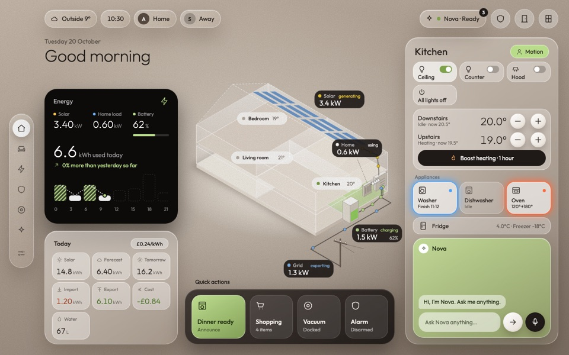<br>Classic</td><td>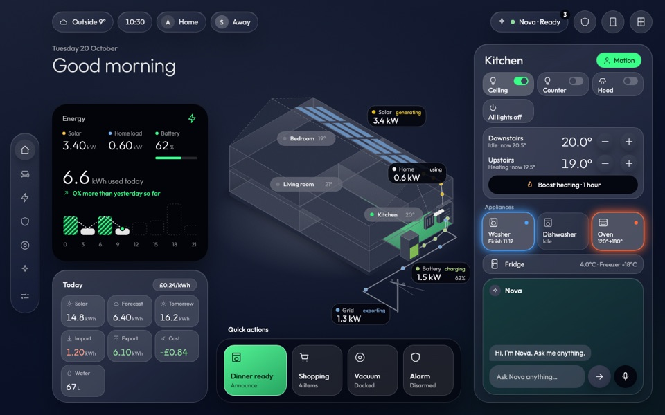<br>Midnight Signal</td><td>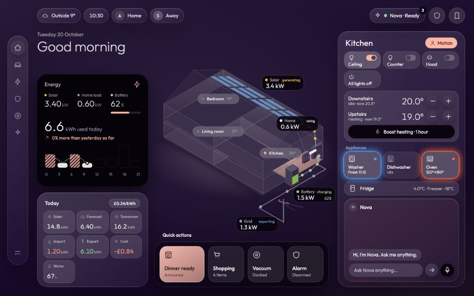<br>Plum Dusk</td></tr>
<tr><td>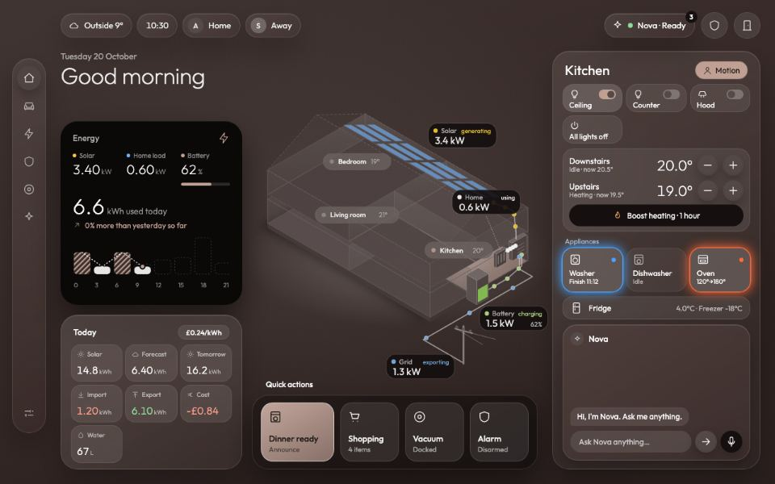<br>Cocoa Bark</td><td>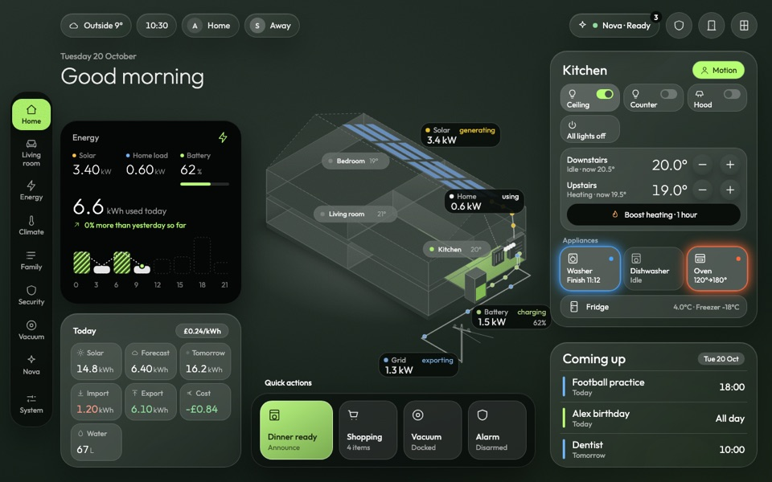<br>Forest Mint</td><td>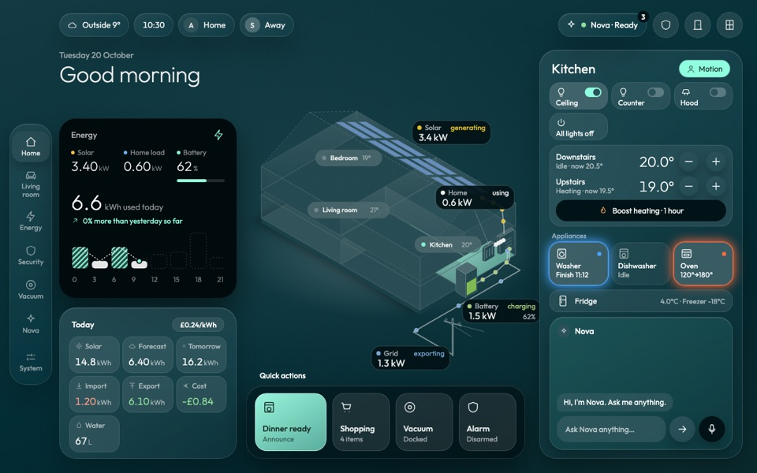<br>Deep Teal</td></tr>
<tr><td>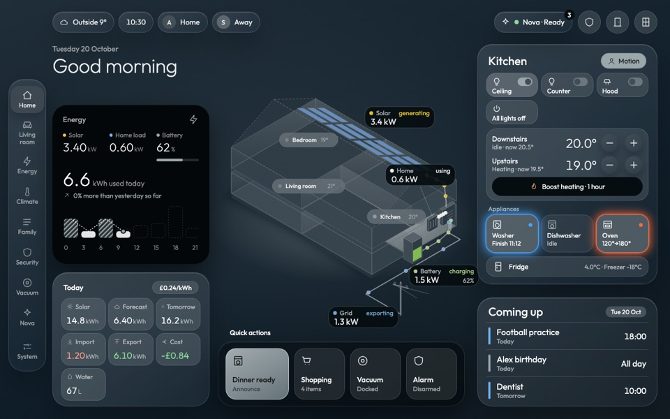<br>Slate Harbour</td><td>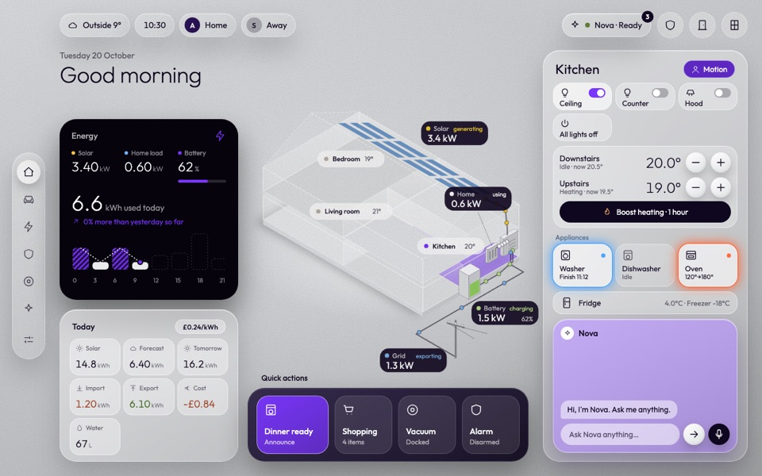<br>Violet Mist</td><td>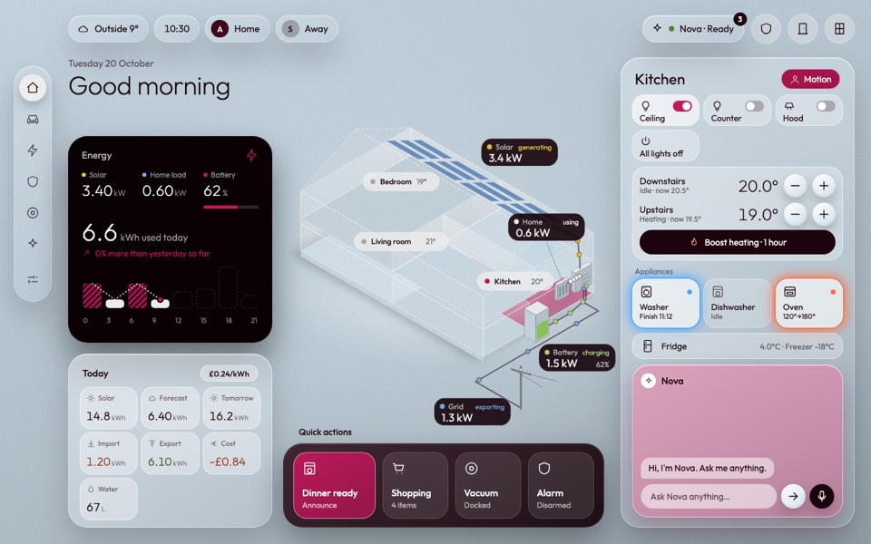<br>Berry Sky</td></tr>
<tr><td>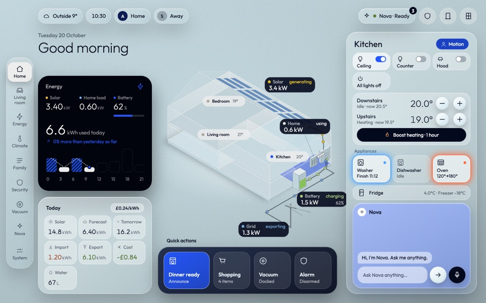<br>Quantum Ice</td><td>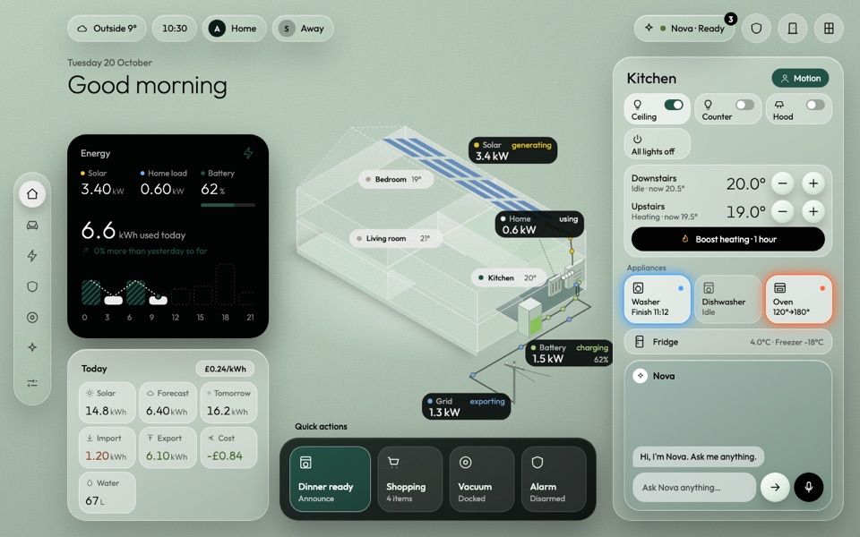<br>Pine Mist</td><td>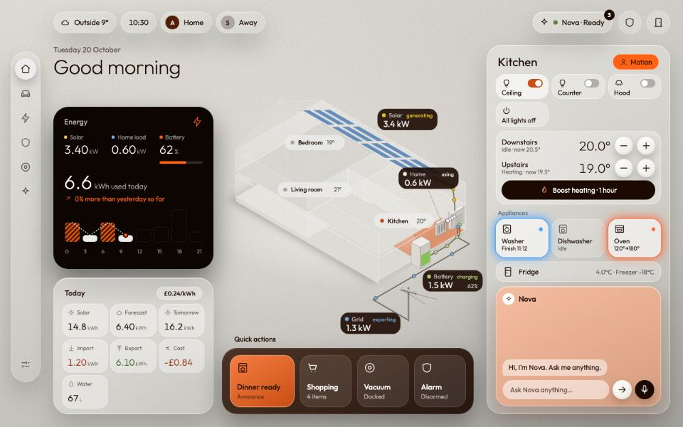<br>Ember</td></tr>
</table>

`general.accent` takes any hex colour. Oriel rebuilds the whole accent family from it (fills, toggles, accent text and the text that sits on accent fills) so it stays readable.

Some colours are the same in every theme because they mean something or belong to a picture: alarm and vacuum states, the energy sources (solar is yellow, grid is blue and so on), light colour swatches, camera overlays, the Living room drawing and the idle clock, which is dark in every theme.

A script checks every theme, Classic included, for 4.5:1 contrast on body text and 3:1 on large text and icons (`node dev/contrast.mjs`, 77 checks per theme). Classic keeps its look, with slightly stronger soft text and darker green, amber and red text than the original so that it passes too.

If the theme id is unknown, the tablet shows Classic and the editor warns you. An accent that is not a hex colour is ignored, with a warning.

An idea for later is a dim mode for night, since the neon accents (Midnight Signal, Forest Mint) can glare on a wall tablet in a dark room.

## Scene style

The scene style is an optional tablet look. Turn it on with `general.page_style: scene`, or in the editor under General › Page style on the tablet. It is off by default.

On Energy, Climate, Household, Security, Vacuum and System, each page gets:

- a short line and a large title at the top left, such as *Live · 18:04 · £0.24/kWh now* or *Read-only · last event 17:52*;
- status chips under the title, built from your entities (the alarm, open doors, heating, bins and so on);
- a drawing of what the page is about, with live labels on it;
- compact cards in one row along the bottom, sized to fit the screen without scrolling sideways.

Tap a compact card to open the page's full card in a pop-up, with all of its controls and confirm steps. Tap outside it, press the × or press Escape to close it. On Climate, the − and + on the compact card change the thermostat exactly as the full card does. On Vacuum, with a Dreame room map, the Clean a room card opens the map with its room buttons.

While the scene style is on, every page uses its warm dusk look (warm light, frosted glass and white text) whatever theme you picked. Home, Living room and Nova keep their own layouts. The phone layout ignores the style.

The drawings are generic and drawn in code. Labels and chips only appear for entities you have set.

<table>
<tr><td>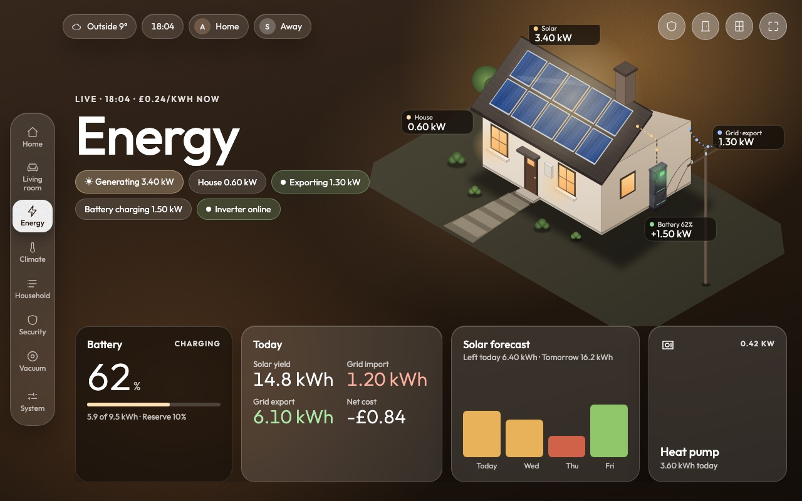</td><td>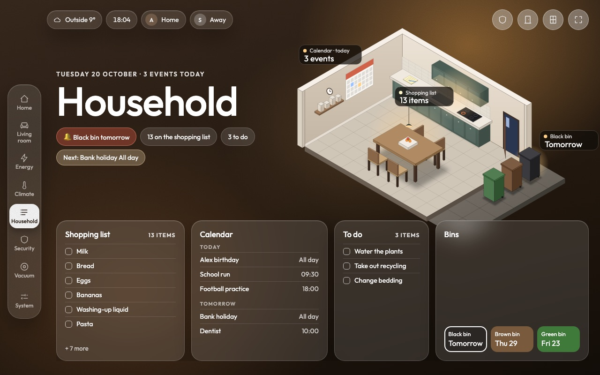</td></tr>
</table>

## Idle clock

The idle clock is a dark screen that covers the card when nobody has been in the room for a while, and goes away when someone comes back. It is not a page in the rail. It stays off until you set `general.idle_clock.presence` to a presence sensor, which can be any `binary_sensor` or `input_boolean` that is `on` while someone is there.

It appears once the sensor has been `off` for `minutes` (default 5, from 1 to 60). A touch anywhere on the dashboard restarts the count.

It goes away when the sensor turns `on`, or when anyone taps the screen. You land back on the page that was open, and the tap that wakes the screen does not press anything underneath.

Bad data counts as someone being there. A sensor that is `unavailable`, `unknown` or missing never starts the clock, and it removes the clock if it is showing. After a tablet reload with the sensor already off, the count starts from the sensor's own `last_changed`.

It never covers anything urgent. It is not shown, and is removed, while a camera pop-up is open, while the doorbell (`security.doorbell`) is on, or while the alarm (`security.alarm`, else `general.alarm`) is pending or triggered.

It shows the time in your locale's format, the date, and up to three chips, each hidden when it has no data: the weather (`general.weather`), the next event from `family.calendars` with its colour bar and time (the same events as the Home Coming up card), and "Bin today" or "Bin tomorrow" with the bin names from `family.bins`.

The screen is dark and warm in every theme on purpose. Its content drifts a few pixels in a slow loop every minute so nothing stays lit in one place; with reduced motion on, it does not move.

It is not shown in the card editor's preview. It only covers the card, so if the Home Assistant header and sidebar are visible, they stay visible.

## Auto rotation

Auto rotation moves through the pages by itself, in rail order, then starts again from the first. It is off unless you turn it on.

```yaml
general:
  auto_rotate:
    enabled: true             # default false
    idle_seconds: 60          # seconds on each page (5 to 3600, default 60)
    after_touch_seconds: 300  # wait after a touch or a page change (5 to 86400, default 300)
```

It follows the rail's order, with System last. On the phone it also steps through the pages under More. Pages that do not show are skipped, and with only one page nothing happens.

When a person changes the page (a tap on the rail or tab bar, or any other change that is not automatic), the next automatic move waits `after_touch_seconds` from that moment and then carries on every `idle_seconds`. A touch anywhere on the card restarts that wait.

It holds off, and tries again later, while the idle clock is showing, while a pop-up, sheet, More menu or dialog is open, while a text field has focus (typing to Nova, for example), or while the browser tab is hidden. Once nothing is in the way, the next move comes after one full `idle_seconds`.

It changes pages the same way a tap does, so the slide and the fade run as usual. Home Assistant updates never reset its timer. There is only one timer: it stops when the card is removed and restarts on a config change without a reload. It does not run in the card editor's preview.

The System page has an Auto rotate switch (on the phone too) with the timings shown underneath, for example "Every 60 s, 5 min after a touch". The switch is per device: once someone flips it, that browser remembers the choice and it wins over `enabled` on that device. Until then `enabled` decides. Flipping it takes effect at once and counts as a touch, so the first move waits `after_touch_seconds`. If the browser blocks storage, the page still works and uses `enabled`, and a flip only lasts until the card reloads. The timings themselves stay in the config.

## Phone layout

The same card, pages, themes and config work on a phone. Nothing in your config changes, only the layout.

The phone layout turns on when the card is narrower than 700 px, measured on the card itself, so the card editor's preview and a card in a narrow column get it too. A landscape phone wider than 700 px keeps the tablet layout. Force either one with `general.layout: phone` or `tablet`.

Every page has a phone version: one column of full-width cards that scrolls, with two columns of tiles where they fit. There is no canvas scaling, and the layout respects the notch and the home bar.

In the header, the weather, clock and people chips scroll sideways in one row, while the alarm, door and window buttons stay fixed on the right. People chips follow `people_display`, so nothing shows a name or picture you did not ask for.

A floating tab bar replaces the side rail. It shows the first four pages in rail order, then More, which opens a sheet with the rest; with five pages or fewer there is no More, and System is always reachable. The bar is frosted glass, tinted more or less strongly per theme so the labels stay readable over whatever scrolls underneath, and a bubble slides to the selected tab, which also gets a heavier label. Without `backdrop-filter` support the bar is solid. With reduced motion on, the bubble jumps instead of sliding.

The shopping list, camera, light tune panel, vacuum settings and confirm steps open as bottom sheets. The page behind does not scroll, the back button or gesture closes the sheet, and each sheet has a close button and closes with a swipe down. Sheets stay above the on-screen keyboard.

Confirm steps (starting the vacuum, cleaning rooms, Nova lockdown) put Cancel first and a large Confirm button well apart from it. A tap meant for the page cannot press Confirm in the first moments after the sheet opens. Read-only pages stay read-only on the phone too: the alarm and locks cannot be controlled from Oriel on any layout.

On Home, the whole house is drawn at the card's width. Room and power labels keep their size (12 px or more), and only the labels that fit without overlapping are shown, power labels first.

A few things work differently from the tablet. There is no idle clock. The Energy charts and the Climate graph are drawn at the card's width. The calendar and bins are one list, lists on Household show every item, and the calendar's "+ N more" expands.

The phone does not poll more often than the tablet. Camera snapshots refresh no faster than on the tablet and stop when the page is not showing.

<table>
<tr>
<td>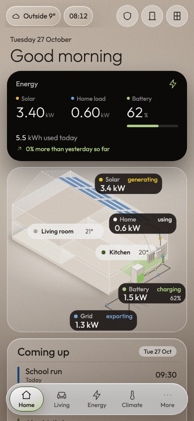<br>Home</td>
<td>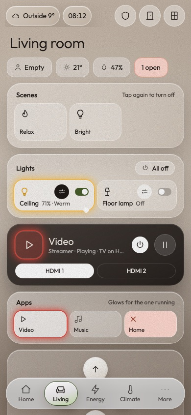<br>Living room</td>
<td>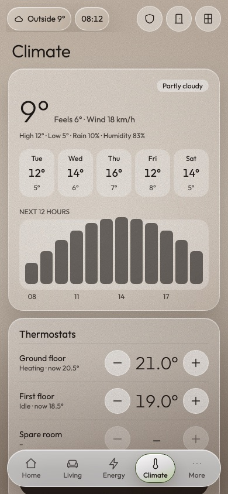<br>Climate</td>
<td>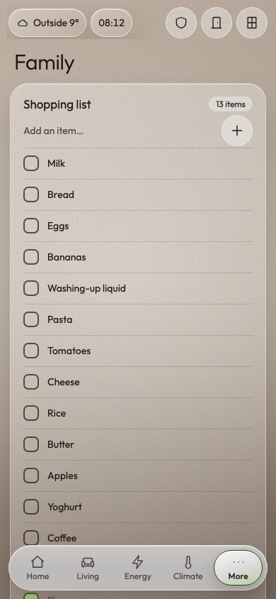<br>Household</td>
<td>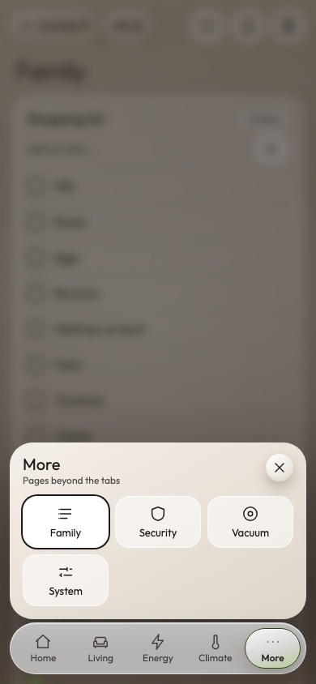<br>More</td>
</tr>
</table>

## Wall tablet setup

Oriel is meant to be the only card on a panel view, so it can fill the screen. It is designed for landscape tablets from about 1280 × 800 up to 1700 wide. Larger screens scale up, and very tall or narrow screens get bands at the edges. Keep the screen awake with your tablet's kiosk browser or its own settings.

The round full screen button at the right of Oriel's header (tablet layout only) hides Home Assistant's header and sidebar and asks the browser for full screen, which also hides the browser's bars where the app allows it. Tap it again to bring everything back. You do not need an add-on for this.

- Each device remembers the choice. After a reload the header and sidebar stay hidden until you tap the button again. The browser's own full screen needs a tap, so its bars come back after a reload.
- It works by adding a small style to Home Assistant's page, using the rules from the [kiosk-mode](https://github.com/NemesisRE/kiosk-mode) project. A future Home Assistant update could change that page; if the header stops hiding, update Oriel.
- The button is not shown in the phone layout or in the card editor's preview, and the header and sidebar come back when you leave the dashboard.
- If you already use kiosk-mode, it still works alongside. Add `?disable_km` to the dashboard URL to get out of it.

## Troubleshooting

| Problem | What to try |
|---|---|
| A value shows a dash | The entity is missing, unavailable or not a number. Turn on `system.debug_panel` to list every configured entity with a problem. |
| A page is missing from the rail | It has no entities set yet. Set at least one in its section. |
| The card is not in the card picker | The resource is not loaded. Check Settings › Dashboards › Resources, then hard-refresh. |
| An update does not show | Reset the frontend cache in the Companion app, or hard-refresh the browser. With a manual install, also raise the `?v=` number on the resource. |
| The visual editor says its form components did not load | Use Show code editor. Every option is listed in [Configuration](configuration.md). |
| The Nova page says "Nova not detected" | Install the Nova integration, or turn `nova.enabled` off. |
| The live camera view does not start | Oriel uses `webrtc-camera` if it is installed, otherwise Home Assistant's own live view. Check the camera works in Home Assistant first. |
| The house pills overlap | Nudge them with `pill_offset`. |
| A phone shows the tablet layout, or the other way round | `auto` goes by the card's own width: under 700 px is the phone layout. Set `general.layout` to `phone` or `tablet` to force one. |

For more detail, open the browser console and look for lines starting with `[oriel]`.

## Accessibility

All controls are real buttons with labels, and keyboard users get a visible focus ring. List items in the editor can be reordered with buttons as well as by dragging. Animations stop when the system asks for reduced motion.
